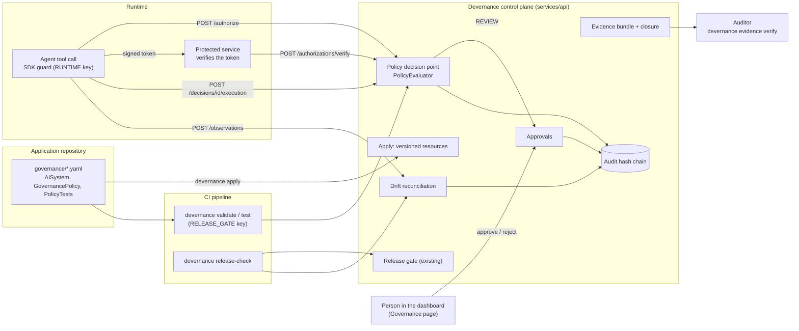
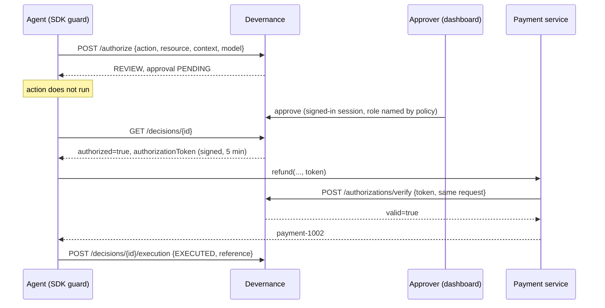

# Devernance governance runtime

This document explains the governance runtime: what it is, how its parts fit together, how a developer uses
it, and what it does not do. It is written so that someone new to the project (or a less capable coding
model) can work on it without guessing.

Related documents:

| Document | What it covers |
|---|---|
| [GOVERNANCE_POLICY_REFERENCE.md](GOVERNANCE_POLICY_REFERENCE.md) | Every field of the `AISystem`, `GovernancePolicy` and `PolicyTests` manifests |
| [GOVERNANCE_CLI.md](GOVERNANCE_CLI.md) | The `devernance` command and the Python SDK, with exit codes and CI setup |
| [API.md](API.md#governance-runtime) | The HTTP routes, request and response bodies |
| [SCHEMA.md](SCHEMA.md#governance-runtime-v33) | The four database tables |
| [../examples/claims-agent/](../examples/claims-agent/) | A runnable insurance claims agent that uses all of it |

## 1. The idea in one paragraph

Devernance already knew which AI systems a company has, how risky they are, and whether a release has the
evidence, evaluations and sign-offs it needs (the release gate). The governance runtime adds the part that runs
while the AI is working: a policy, written as code next to the application, decides whether an agent may take
an action (ALLOW, DENY, or REVIEW = a person must approve first). Every decision is stored with the exact policy
version that made it. Deployments report what they actually run, and any difference from the approved state is
drift. All of it can be exported as a signed bundle that an auditor verifies without trusting Devernance.

In short: **Define → Check → Enforce → Approve → Reconcile → Verify.**

| Step | What happens | Where |
|---|---|---|
| Define | Write `AISystem` and `GovernancePolicy` manifests in the repository | `governance/*.yaml`, `devernance apply` |
| Check | Before release: do system and policy fit? Does the policy answer the test cases as expected? | `devernance validate`, `devernance test`, `devernance release-check` |
| Enforce | At runtime, before each sensitive action, the agent asks for a decision | SDK `guard` / `governed`, `POST /authorize` |
| Approve | REVIEW decisions wait for a person with a role the policy names | Dashboard → Governance |
| Reconcile | Deployments report model, prompt, tools, policy version; differences are drift | `report_state`, `devernance drift` |
| Verify | Signed evidence bundle; per-rule evidence closure report | `devernance evidence export/verify`, `devernance closure` |

## 2. Why it is built this way

Four principles decide most design questions. When in doubt, follow them.

1. **Enforcement happens outside the model.** A system prompt saying "do not refund more than 50,000" is not
   enforcement. The policy is evaluated by Devernance, and the SDK refuses to run the action unless the answer
   allows it. The LLM cannot talk its way past it.
2. **Fail closed.** Missing information denies. If the policy needs `context.amount` and the request has none,
   the answer is DENY, not ALLOW. If Devernance cannot be reached, the SDK raises `GovernanceUnavailable` and
   the action does not run. An action no rule covers is denied unless the policy says `defaultDecision: allow`.
3. **Every decision is reproducible.** Manifests are never edited in place; each change is a new version. A
   decision stores the system version, the policy version and a hash of the request, so later anyone can see
   exactly which rules applied. The evaluator is a pure function (`PolicyEvaluator`): same inputs, same answer.
4. **Never claim more than can be proven.** The evidence bundle says in its own manifest that it cannot prove
   every real-world action asked for permission. The closure report marks a rule OPEN when it was never
   exercised or when an allowed action's outcome was never reported. Drift is "not reported" until a deployment
   reports; it is never assumed to be in sync.

## 3. Architecture



### 3.1 Where the code is

| Part | Path | Notes |
|---|---|---|
| Database tables | `services/api/src/main/resources/db/migration/V33__governance_runtime.sql` | 4 tables, all tenant-scoped |
| Java package | `services/api/src/main/java/os/assurance/eu/api/governance/` | See the class map below |
| HTTP routes | `GovernanceController` → `/api/v1/governance/*` | One controller, grouped by purpose |
| API key scope | `tenant/ApiKeyScope.java` | New `RUNTIME` scope for agents |
| Python SDK + CLI | `sdk/python/devernance/` | Standard library + PyYAML only |
| Dashboard page | `apps/dashboard/app/(dashboard)/governance/page.tsx` | Systems, approvals, decisions, drift |
| Example | `examples/claims-agent/` | Manifests, tests, agent tools, scenario runner |
| End-to-end proof | `scripts/governance-e2e.sh` | Real API + CLI + SDK; runs in CI |

### 3.2 Java class map (`governance` package)

Read them in this order; each builds on the ones before.

| Class | Responsibility |
|---|---|
| `SpecReader` | Reads manifest maps and collects every problem (unknown keys are errors) |
| `SystemSpec` | Parsed `AISystem` spec: owner, risk, model, prompt hash, tools |
| `PolicySpec` | Parsed `GovernancePolicy` spec: rules, conditions, reviews, enforcement settings |
| `PolicyEvaluator` | **Pure** decision function: `(PolicySpec, Request) → ALLOW / DENY / REVIEW` |
| `GovernanceValidator` | **Pure** check that a system and its policy fit (ungoverned tools, denied tools, model) |
| `GovernanceManifest` | Parses the `apiVersion/kind/metadata/spec` envelope of each manifest |
| `GovernanceJson` | Canonical JSON (sorted keys) and SHA-256, used for every hash |
| `GovernanceRegistry` | Looks up the active system and policy for the current tenant |
| `GovernanceApplyService` | `apply`: create a new version or report `unchanged`; registers the AI system |
| `GovernanceAuthorizationService` | `authorize`, approvals, execution reports, authorization tokens |
| `GovernanceDriftService` | Observations and drift reports (approved vs observed) |
| `GovernanceCheckService` | `validate`, `simulate` (policy tests), `release-check`, `status`, `graph` |
| `GovernanceEvidenceService` | Signed evidence bundle and the evidence closure report |
| `GovernanceCaller` | Who is calling: the API key's name, or `user:<id>` for a person |
| `GovernanceController` | HTTP routes; no logic beyond translating requests |

Entities (`Governance*Entity`) and repositories (`Governance*JpaRepository`) follow the project pattern. Every
repository query includes `tenantId`.

## 4. The resource model

Two kinds of resources are applied. Both are versioned: a change adds a new row with `version + 1` and marks the
old one inactive. Applying an identical manifest is a no-op (`unchanged`), detected by `content_sha256`.

| Kind | Describes | Key fields |
|---|---|---|
| `AISystem` | The approved state of one AI system | model `name@version`, `promptHash`, `tools`, risk class |
| `GovernancePolicy` | What that system may do | `models.approved`, `tools` (tool → action), `rules`, `enforcement` |

Rules:

- One `GovernancePolicy` is active per system. Applying a new policy that targets the same system replaces the
  previous one.
- Applying an `AISystem` also creates or updates the system in the existing AI system registry (same code path as
  the dashboard), so plan limits, controls, approval workflows and audit events still apply. Bind a manifest to an
  already registered system with `metadata.systemId`.
- `PolicyTests` documents are not applied. They only feed `devernance test`.

The **governance resource graph** (`GET /graph`, `devernance graph`) is derived from these: system → model,
system → tool, tool → action, action → rule, policy → rule.

## 5. Runtime decisions in detail

### 5.1 Life of one request



### 5.2 Evaluation order

`PolicyEvaluator.evaluate` checks these in order; the first that applies gives the answer:

1. The request names a model that is not on `models.approved` → **DENY** (rule `models.approved`).
2. No rule covers the action → the policy's `defaultDecision` (deny unless set to allow) (rule `defaultDecision`).
3. The rule says `deny` → **DENY**.
4. A `require` condition is false or cannot be evaluated → **DENY**.
5. A `review` entry cannot be evaluated → **DENY**; all its `when` conditions hold → **REVIEW**.
6. Otherwise → **ALLOW**.

Before the evaluator runs, the service also denies when the system has no policy, and when the policy has
`enforcement.onDrift: block` and any environment of the system has drifted (rule `enforcement.onDrift`). The
`environment` in an authorize request is recorded but never used to pick which drift counts: the agent chooses it,
so trusting it would let an agent name a clean environment and step around drift reported in production.

The most specific rule wins: an exact action (`payment.refund`) beats a prefix (`payment.*`), a longer prefix beats
a shorter one, and `*` is last.

### 5.3 What "authorized" means

The response field `authorized` is the only one a caller should act on:

| Status | `enforced` | Approval | `authorized` |
|---|---|---|---|
| ALLOW | true | — | true |
| DENY | true | — | false |
| REVIEW | true | PENDING / REJECTED / EXPIRED | false |
| REVIEW | true | APPROVED (not expired) | true |
| any | false (policy `runtime: monitor`) | none is created | true |

Monitor mode records what would have happened without blocking. Use it to roll a policy out safely, then switch
to `enforce`.

### 5.4 The authorization token (second enforcement point)

The SDK wrapper protects the agent's own code path. Another code path could still call the payment service
directly. So an authorized decision comes with `authorizationToken`: a JWS signed with the same RS256 keys as
evidence packs (`/.well-known/jwks.json`). It binds the decision id, the tenant, the action and a SHA-256 of the
exact request (action + resource + context), plus the system whose policy decided it. Because the token is a bearer
credential for the protected service, it is only handed to the caller that made the request (the same API key, or
the same person in a session); anyone else who reads the decision sees it without a token. The protected service
calls `POST /authorizations/verify` with the token, the system it protects, and the request it is about to execute.
It is valid only if:

1. the signature verifies and the token is for this workspace;
2. it was issued for the named system (a token decided under a permissive system's policy cannot be spent at a
   service that protects a stricter one);
3. it has not expired (default 300 s, `assurance.governance.authorization-ttl-seconds`);
4. the request is the same one;
5. the decision still authorizes it;
6. it was not used before.

**One use.** The first successful verify redeems the token (`token_redeemed_at`, audit event
`governance.authorization_redeemed`) under a row lock, so a replay fails even before the agent reports the outcome,
and two services presenting the same token at once cannot both succeed. If the action then fails, the agent asks
for a new authorization.

The request hash compares numbers by value, so `75000` and `75000.0` match. Every string and number is tagged with
its type before hashing, so the string `"75000"` never matches the number `75000`: the policy judged the request
with its real types, and the protected service must present the same ones.

### 5.5 Approvals

- Created automatically for an enforced REVIEW decision. Expires after `expiresAfterMinutes` (default 24 h).
- Answered only in a signed-in session (`SessionOnly`): **an API key can never approve**, so a compromised agent
  key cannot approve its own requests.
- Only roles listed in the policy's `approverRoles` may answer (default `ADMIN`, `COMPLIANCE_OFFICER`).
- A person cannot answer a request they made, either in their own session or through an API key they created (a key
  acts as its creator, so whoever creates an agent's key is accountable for what it asks).
- A rejection needs a rationale.
- An approval that is never used expires too; the action must then be asked for again.

### 5.6 Execution outcomes

After an authorized action, the caller reports `EXECUTED` or `FAILED` once (`POST /decisions/{id}/execution`).
Only the caller that requested the decision (the same API key, or the same person in a session) may report it, so
another agent in the workspace cannot burn the authorization or claim the action ran (403). Reporting an outcome for a decision that does not authorize the action is refused with 409, and the refusal itself
is written to the audit chain (`governance.execution_refused`), because it means something tried to act without
permission.

## 6. Drift (reconciliation)

A deployment reports what it actually runs (`POST /observations`, SDK `report_state`, CLI `report-state`):
`model`, `promptHash`, `tools`, `policyVersion`, for one `environment` (default `production`). Each property is
compared with the active `AISystem` and policy:

| Property | In sync when |
|---|---|
| `model` | equals the approved `name@version` (an approved model without a version accepts any version) |
| `promptHash` | equals the approved `promptHash` (only compared when the manifest declares one) |
| `tools` | the same set as the approved `tools` |
| `policyVersion` | equals the active policy version |

Drift is recomputed on every read against the current approved state. So approving a change (applying the updated
`AISystem` manifest) clears the drift immediately. Properties a deployment does not report are not compared.

What drift does:

- `devernance release-check` returns BLOCKED (or REVIEW with `enforcement.deployment: advisory`).
- The drift report includes a reassessment: whether the new model is on the approved list, and what to do.
- With `enforcement.onDrift: block`, every runtime decision for the system is denied while any environment has
  drifted, until it is fixed. The default (`continue`) keeps serving while the change is reassessed.
- Every environment that ever reported is checked (`findEnvironments`), not a window of recent reports, so many
  reports from one environment cannot hide another environment's drift.
- Audit events `governance.drift_detected` and `governance.drift_resolved`.

Where to report from: the agent at startup and on a timer (SDK), a CI deploy step (CLI), or a Kubernetes job that
reads the running pod spec. See [GOVERNANCE_CLI.md](GOVERNANCE_CLI.md#reporting-drift-from-a-deployment).

## 7. Evidence

### 7.1 Signed evidence bundle

`GET /evidence-bundle?system=...&from=...&to=...` (CLI: `devernance evidence export`) returns:

```
manifest.json                 file list with SHA-256 of each file, counts, period, audit chain head, limitation
signature.jws                 RS256 JWS over the manifest's SHA-256
jwks.json                     (written by the CLI) public keys at export time
systems/<name>-v<N>.json      every system version a decision refers to
policies/<name>-v<N>.json     every policy version a decision refers to
decisions/<id>.json           each decision: agent, request, policy + system version and their hashes
approvals/<decision-id>.json  who approved or rejected, when, why
executions/<decision-id>.json reported outcome
drift/observations.json       every observation in the period
```

Each file is returned exactly as hashed, so verification never re-serializes JSON. `devernance evidence verify`
(standard library only, under 200 lines in `sdk/python/devernance/verify.py`) checks the signature, the manifest
hash, every file hash, and that no unlisted file was added. For an independent check, pass the issuer's own key
URL (`--jwks https://<api>/.well-known/jwks.json`) instead of the copy inside the bundle.

### 7.2 Evidence closure

`GET /closure` (CLI: `devernance closure`) answers, for each policy rule: is there a requirement, an enforcement
mechanism, observed decisions, and reported outcomes? A rule is **CLOSED** only when nothing is missing. Gaps it
reports:

- the policy runs in monitor mode (nothing blocked);
- no decision used the rule in the period (enforcement not demonstrated);
- authorized actions whose outcome was never reported;
- the audit chain does not verify.

It deliberately does not mark a rule closed because a document exists.

## 8. Security model

| Threat | Control |
|---|---|
| A prompt-injected agent tries a forbidden action | Policy evaluated outside the model; SDK does not run the action unless `authorized` |
| A leaked agent key | `RUNTIME` scope: can only authorize, read decisions, report outcomes, verify tokens, report state. Cannot apply policies, approve, or read other records |
| An agent approves its own request | Approvals need a signed-in session; API keys are refused; the requester and the creator of the requesting key may not answer |
| Someone else picks up an authorization token | Tokens are minted only for the caller that made the request; lists never carry them |
| A code path skips the SDK | Protected service verifies the signed, single-use, request-bound token |
| A caller claims to be another agent | `agent` comes from the authenticated key's name, never from the request body |
| Missing data or unreachable server | Fail closed: DENY or `GovernanceUnavailable` |
| Records changed later | Every step is on the HMAC audit chain; bundles are signed and hashed |
| Cross-tenant access | Every query is scoped by `tenantId`; tested in `GovernanceApiTest.anotherWorkspaceSeesNothing` |
| Oversized requests | `resource` and `context` at most 16 KB each; manifests at most 64 KB; lists capped |

## 9. The worked example: an insurance claims agent

`examples/claims-agent/` implements the company rules:

1. The agent reads only the customer of its authorised claim → `customer.read` with
   `require: resource.customer_id eq context.authorized_customer_id`.
2. Refunds above 50,000 need human approval → `payment.refund` with a `review` when `context.amount gt 50000`,
   approver `COMPLIANCE_OFFICER`.
3. Customer data is never exported → `customer.export: deny`; and a tool `export_all_customers` that is not mapped
   fails `devernance validate` before it can ship.
4. Only approved model versions run → `models.approved`; drift detection catches a model swapped outside the
   governed process.
5. Every payment action has an audit trail → every decision, approval and outcome is on the audit chain and in the
   evidence bundle.

Run all of it against a real API: `scripts/governance-e2e.sh`. It starts the API, creates one key per workload,
validates and tests the manifests, shows that a pull request with an ungoverned tool fails, applies, runs the
agent (20,000 allowed and paid; 75,000 paid only after a compliance officer approves; another customer's record
denied; the export tool denied; a forged token refused by the payment service), detects drift, exports and
verifies a bundle, shows a one-character edit is caught, and verifies the audit chain.

## 10. What is not built yet

Be honest about these in sales material and docs. They are the natural next steps, in rough priority order.

| Not yet | Why it matters | Sketch |
|---|---|---|
| Local decision point (sidecar) with signed policy distribution | Today every decision is a network call to the control plane; latency and availability depend on it | Export active policies as signed bundles; a sidecar evaluates locally with the same `PolicyEvaluator` rules and uploads decisions |
| Kubernetes operator | Drift is reported by the workload or CI today | Watch Deployments with a `devernance.io/system` label; report image, env-declared model and tools |
| OPA / Cedar adapter | Some companies already write Rego or Cedar | Let a rule delegate to an external engine and record its answer and bundle revision |
| Java and TypeScript SDKs | Only Python ships | The HTTP API is small (see API.md); port `client.py` |
| MCP gateway | Tool calls through MCP could be governed without changing agent code | A proxy MCP server that calls `/authorize` per tool call |
| Trusted timestamps (RFC 3161) on bundles | Proves when a bundle existed | Timestamp the manifest hash |
| Multi-approver (N of M) reviews | Some actions need two people | Extend `governance_approvals` with required count |

The release gate, risk classification, evidence RAG, evals, data contracts, approval workflows for releases and
audit chain all existed before this runtime and are unchanged. None of this is a legal certification.

## 11. Working on this code

This section is for contributors, human or AI. Follow it literally.

### 11.1 Rules that must not be broken

1. **Fail closed.** Missing or wrongly typed facts DENY. An action no rule covers is denied unless the policy says `defaultDecision: allow`. The SDK raises `GovernanceUnavailable` and never runs the action when the API cannot be reached.
2. **`PolicyEvaluator` and `GovernanceValidator` stay pure** (no clock, no DB, no Spring). Decisions must be reproducible from the stored request and policy version.
3. **Resources are immutable.** A change adds a new version (`version + 1`) and marks the old row `active = false`. Never update `spec_json`.
4. **Unknown manifest keys are errors** (`SpecReader.onlyKeys`). When adding a field, add it to the `KEYS` set, the parser, `docs/GOVERNANCE_POLICY_REFERENCE.md`, and a test.
5. **Approvals need a signed-in session** (`SessionOnly.require`), a role in the policy's `approverRoles`, and a different person from the requester (and from the creator of the requesting API key). API keys can never approve.
6. **Agent identity comes from the credential** (`GovernanceCaller`: the API key's name), never from the request body.
7. **Every state change appends an audit event** (`governance.*`). Every query filters by `tenantId`.
8. **Never claim more than is proven.** Evidence closure marks rules OPEN when unexercised or unreported; drift is "not reported" until a deployment reports.
9. **Nothing the agent sends may weaken enforcement.** Request fields (`environment`, `model`, `resource`, `context`) are facts to judge, never switches that pick which checks apply. Example: `onDrift: block` checks every environment, not the one the request names.
10. **An authorization is spent once, by its owner, for one system.** `verify` redeems the token under a row lock and checks the system; only the requester records the outcome; the request hash tags every string and number with its type. Keep all three when touching tokens.

### 11.2 How to add things (step by step)

- **A new condition operator:** add it to `PolicySpec.OPERATORS`, handle it in `PolicySpec.operandsFit` (what `value` it needs) and `PolicyEvaluator.test` (return `Truth.UNKNOWN` for missing or wrongly typed data), add cases to `PolicyEvaluatorTest`, document it in `GOVERNANCE_POLICY_REFERENCE.md`.
- **A new validation finding:** add it to `GovernanceValidator.validate` with a stable `code`, add a case to `GovernanceValidatorTest`, add the code to the findings table in the reference doc.
- **A new drift property:** add it to `GovernanceDriftService.ObservationRequest`, `record` (bounded input), `differences`, and `reassess` (a note saying what to do), then `SystemSpec` if it needs an approved value, the SDK `report_state`, the CLI `report-state`, and docs.
- **A new route:** put logic in a service, keep `GovernanceController` thin, call `authorization.requireAnyRole(...)` for writes, decide whether `RUNTIME` or `RELEASE_GATE` keys may call it (`ApiKeyScope` route lists), add a test in `GovernanceApiTest` (including another workspace getting 404), and document it in `docs/API.md#governance-runtime` and `docs/ROLE_MATRIX.md`.
- **A new table:** new Flyway migration (`V34__...`), add it to `WorkspacePurgeJob.PURGE_SQL` children-first (the schema guard test fails otherwise), and to `docs/SCHEMA.md`.

### 11.3 Commands

```bash
cd services/api && mvn test -Dtest='PolicyEvaluatorTest,GovernanceValidatorTest,GovernanceApiTest'
cd sdk/python && python3 -m unittest discover -s tests -t .
scripts/governance-e2e.sh            # real API (port 18080) + CLI + SDK + approval; ~2 minutes
```
