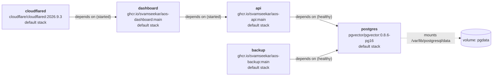
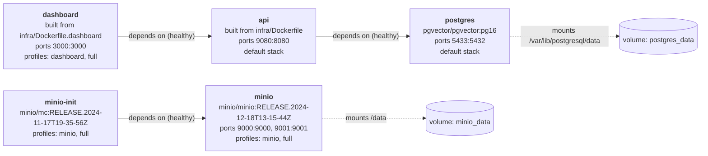
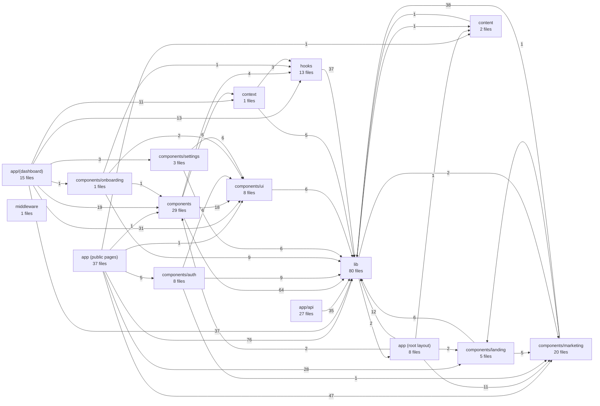
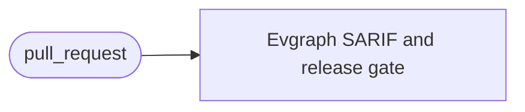
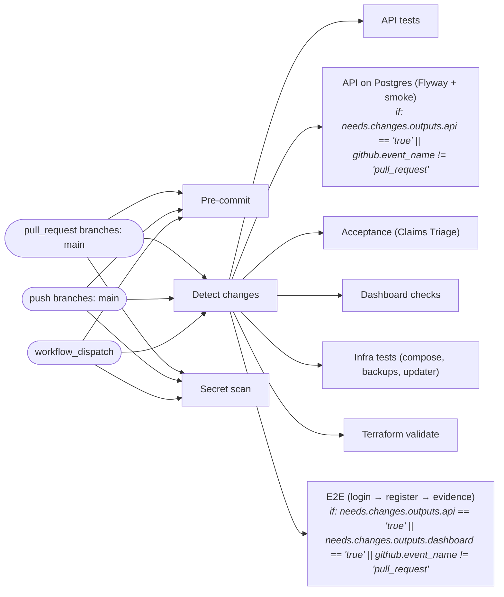
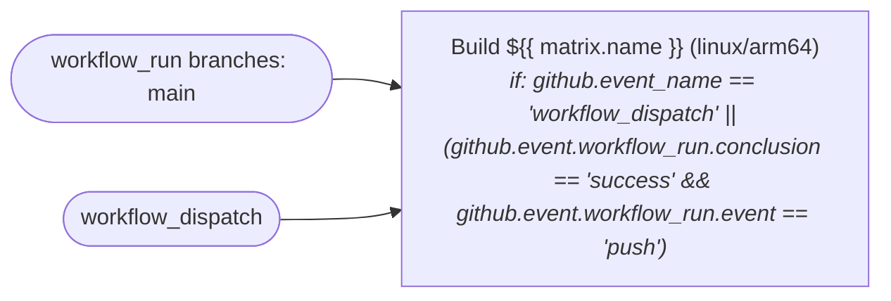
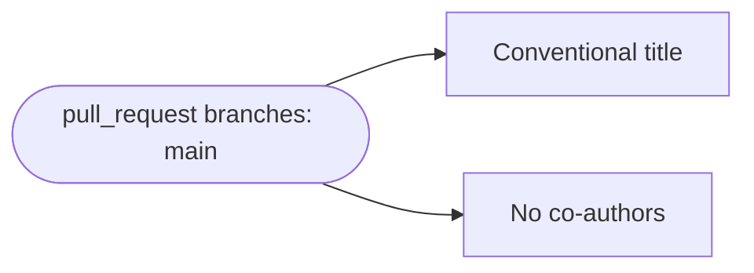
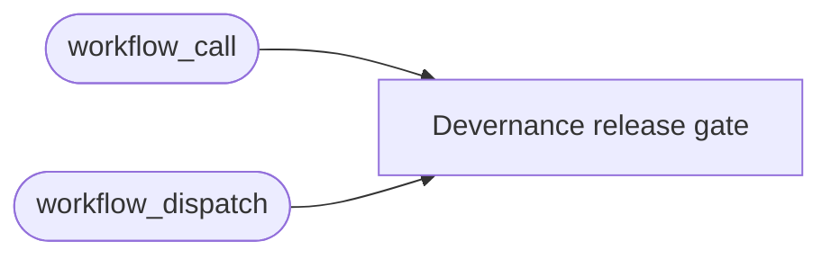
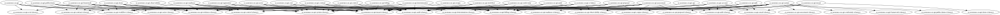

# Diagrams

Generated by `scripts/gen-diagrams.sh` from source, migrations, Compose,
Terraform and workflow files. Do not edit by hand; re-run the script.

## Production topology (infra/docker-compose.prod.yml)

## Local runtime topology (Docker Compose, all profiles)

## Runtime topology (Dell lab overlay)

## Dashboard module areas

Imports between dashboard folders; edge labels count import statements.

## CI/CD pipelines

### Artifact scan (`.github/workflows/artifact-scan.yml`)

### CI (`.github/workflows/ci.yml`)

### Images (`.github/workflows/images.yml`)

### PR title (`.github/workflows/pr-title.yml`)

### Release gate example (`.github/workflows/release-gate-example.yml`)

## API package dependencies

Package-level dependencies inside the Spring Boot API (jdeps).

