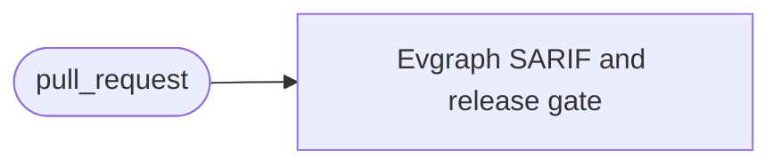
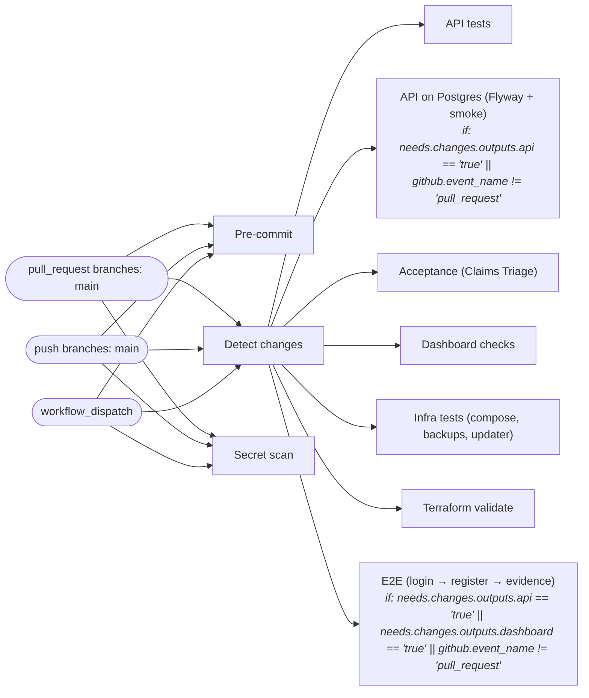
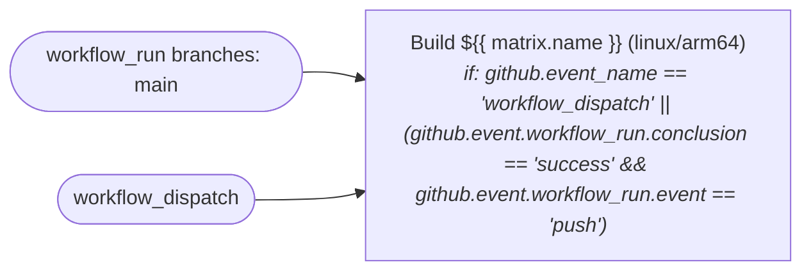
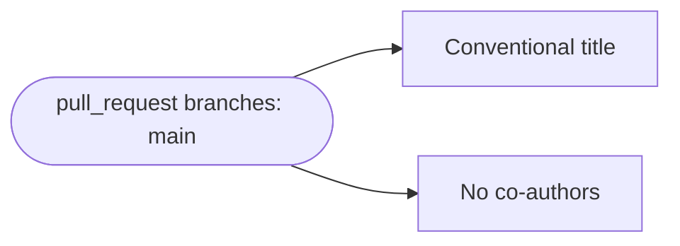
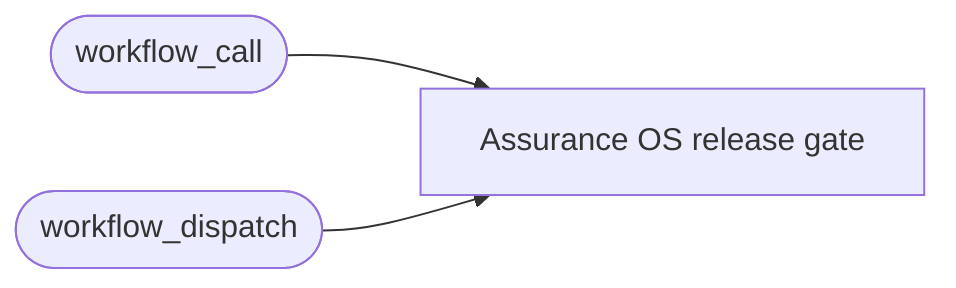

### Artifact scan (`.github/workflows/artifact-scan.yml`)

### CI (`.github/workflows/ci.yml`)

### Images (`.github/workflows/images.yml`)

### PR title (`.github/workflows/pr-title.yml`)

### Release gate example (`.github/workflows/release-gate-example.yml`)

